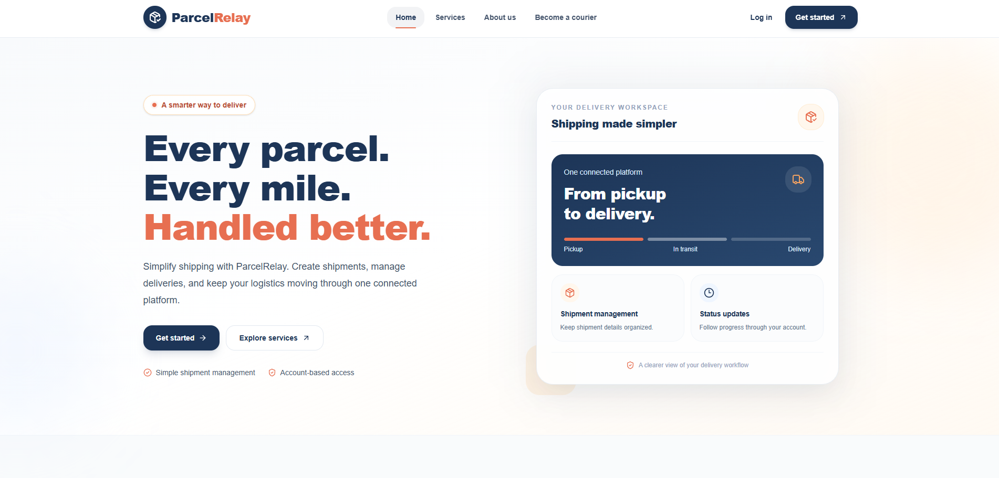

# ParcelRelay Frontend

A responsive courier and logistics management web application built with **Next.js, React, and TypeScript**. ParcelRelay provides role-specific workflows for customers, couriers, and administrators through a modern web interface connected to a REST API.

## Live Application

- **Live Frontend:** https://parcel-relay-frontend.vercel.app
- **Backend API:** https://parcel-relay-backend.vercel.app
- **Frontend Repository:** https://github.com/mahmudulhaque13/parcel-relay-frontend
- **Backend Repository:** https://github.com/mahmudulhaque13/parcel-relay-backend

## Screenshots

### Homepage



<!-- Replace the paths below after uploading screenshots to the repository. -->

<!--
### Homepage


### Dashboard

-->

## Features

### Authentication and Access Control

- Login and registration
- Email verification and password recovery
- Role-specific experiences for Customer, Courier, and Admin
- Protected dashboard areas and role-aware navigation
- Form validation and user-facing error feedback

### Customer

- Create shipments and view shipment details
- View shipment history and shipment status
- Track shipments
- Manage profile information
- View payment-related information

### Courier

- Courier registration and verification workflow
- View assigned shipments
- View shipment details and update shipment statuses

### Admin

- Review courier applications and approve couriers
- Manage hubs and delivery zones
- Manage pricing
- Access administrative dashboards and reports

### Shipment and Payment

- Shipment creation and details
- Public shipment tracking
- Stripe test-payment flow with success and cancellation pages
- Loading, empty, and error states across supported workflows

## Tech Stack

- **Framework:** Next.js App Router
- **UI:** React, TypeScript, Tailwind CSS
- **Data Fetching and Server State:** TanStack Query
- **API Communication:** REST API
- **Payments:** Stripe test mode
- **Deployment:** Vercel

See `package.json` for the complete list of installed dependencies.

## Getting Started

### Prerequisites

- Node.js 18.18 or later
- npm
- A running ParcelRelay backend for API-dependent functionality

### 1. Clone the repository

```bash
git clone https://github.com/mahmudulhaque13/parcel-relay-frontend.git
cd parcel-relay-frontend
```

### 2. Install dependencies

```bash
npm install
```

### 3. Configure environment variables

Create a `.env.local` file in the project root and configure the API base URL using the exact variable name expected by the project's API client.

For example, if the application uses `NEXT_PUBLIC_API_BASE_URL`:

```env
NEXT_PUBLIC_API_BASE_URL=http://localhost:5000/api/v1
```

For the deployed backend, use the appropriate production API base URL:

```env
NEXT_PUBLIC_API_BASE_URL=https://parcel-relay-backend.vercel.app/api/v1
```

**Important:** Verify the variable name and API path against the current source code before using these examples. Never expose private keys, database credentials, JWT secrets, or Stripe secret keys in frontend environment variables.

### 4. Start the development server

```bash
npm run dev
```

Open http://localhost:3000 in your browser.

### 5. Build for production

```bash
npm run build
```

### 6. Run the production server

```bash
npm run start
```

## Main Application Areas

The application includes public pages and role-specific workflows.

- **Public:** Home, About, Services, Pricing, and Contact
- **Authentication:** Login, registration, email verification, and password recovery
- **Customer:** Dashboard, shipment creation, shipment details, payments, and profile
- **Courier:** Dashboard, registration, verification, and assigned shipments
- **Admin:** Dashboard, courier applications, hubs, zones, pricing, and reports
- **Payments:** Success and cancellation pages

Available routes and features may evolve as the application develops.

## Backend Integration

The frontend communicates with the ParcelRelay backend through REST API endpoints.

- **Production API:** https://parcel-relay-backend.vercel.app
- **Backend Documentation:** https://documenter.getpostman.com/view/54934207/2sBYB2s7sn
- **Backend Source Code:** https://github.com/mahmudulhaque13/parcel-relay-backend

The backend handles server-side business logic, authentication enforcement, data persistence, shipment operations, and payment verification.

## Deployment

The frontend is deployed on Vercel.

1. Import the repository into Vercel.
2. Configure the required environment variables.
3. Ensure the backend is deployed and reachable.
4. Configure backend CORS to allow the production frontend origin.
5. Deploy and test the supported authentication, shipment, tracking, and test-payment workflows.

## Author

**Mahmudul Haque**

- **GitHub:** https://github.com/mahmudulhaque13
- **Portfolio:** https://mahmudul-portfolio-xi.vercel.app
- **LinkedIn:** https://www.linkedin.com/in/mahmudul-haque-425113420
- **Email:** m.h.upal13@gmail.com
